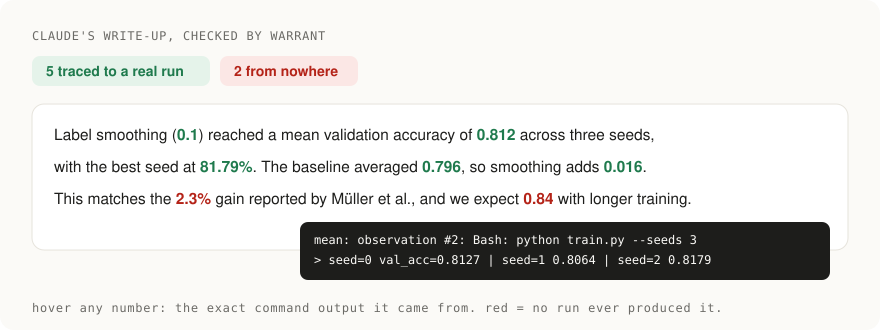
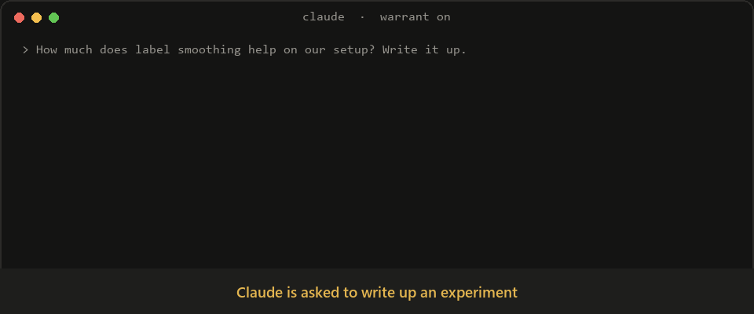
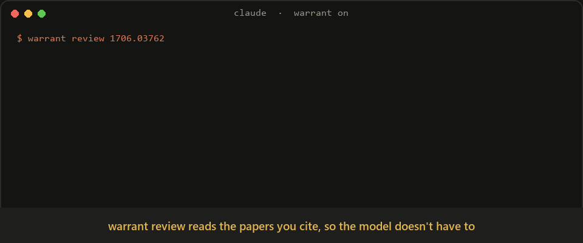
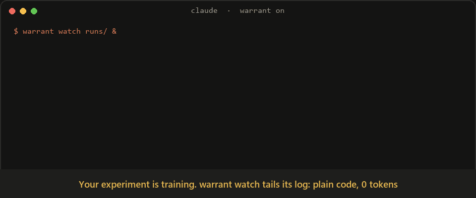
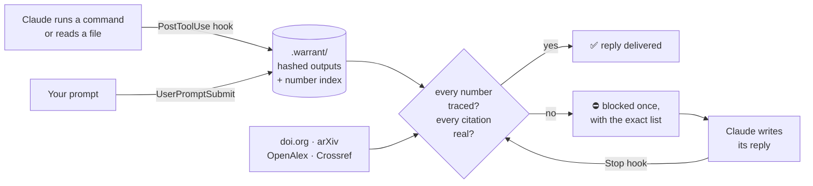

<div align="center">



# The referee that reads every paper you cite.

**warrant checks research claims against their sources: the cited papers' full text, the paper's own tables, and the statistics' own arithmetic. Code does the checking. Where judgment is needed, a model reads 13× less and must quote.**

<a href="https://github.com/ItsShreyamHere/warrant/stargazers"></a>
<a href="#install"></a>
<a href="#install"></a>
<a href="#install"></a>
<a href="pyproject.toml"></a>
<a href="LICENSE"></a>

<table>
<tr>
<td align="center" width="25%"><h3>13× less reading</h3>evidence cards vs. the cited papers' full text<br><sub>measured on arXiv:1706.03762</sub></td>
<td align="center" width="25%"><h3>0 trust in quotes</h3>every model verdict must quote the source verbatim, or it's rejected<br><sub><a href="#warrant-review-a-referee-report-in-one-command">how</a></sub></td>
<td align="center" width="25%"><h3>2,063 p-values</h3>recomputed across 851 psychology papers. 6 papers' own stats contradict their conclusions<br><sub><a href="bench/RESULTS.md">hand-verified results</a></sub></td>
<td align="center" width="25%"><h3>0 dependencies</h3>stdlib Python; hooks add 0 tokens<br><sub>~100 tokens/session for the skill</sub></td>
</tr>
</table>

*Run first. Report second. Cite what exists, and what it actually says.*

**[Install](#install) · [Review a paper](#warrant-review-a-referee-report-in-one-command) · [Watch live runs](#warrant-watch-sentinels-on-your-live-runs-at-0-tokens) · [Live in Claude Code](#what-it-does-inside-claude-code) · [How it works](#how-it-works) · [Limits](#limits-stated-plainly)**



<sub>The block message is the real hook text for that reply. Rendered by <a href="docs/make_demo_gif.py">docs/make_demo_gif.py</a>.</sub>

</div>

---

## Before / after

<table>
<tr>
<th width="50%">Claude alone</th>
<th width="50%">Claude + warrant</th>
</tr>
<tr>
<td valign="top">

> Label smoothing improves accuracy to **0.874** vs 0.809, consistent with Müller et al. (doi 10.48550/arXiv.1906.99999).

A number nobody ran. A DOI that doesn't exist. Both look fine.

</td>
<td valign="top">

> Label smoothing reached **0.812** mean val acc over 3 seeds (`train.py`, seeds 0–2) vs **0.796** baseline. Müller et al. study when this helps (arXiv:1906.02629); their numbers were not reproduced here.

Every number traced to a run or marked `~`. The citation resolves.

</td>
</tr>
</table>

**Same question. One answer you can put in a paper.**

---

## `warrant review`: a referee report in one command

```bash
warrant review 1706.03762        # any arXiv paper, arXiv DOI, or your own LaTeX folder
```



What it checks, and who decides:

| check | how | decided by |
|---|---|---|
| Every reference exists | doi.org · arXiv · OpenAlex · Crossref | **code** |
| A number attributed to a cited paper ("X reaches 92.1% [12]") is in that paper | reads the cited paper's **full text**, matches within rounding | **code** |
| Numbers in the abstract appear in the paper's own body and tables | provenance index of the paper | **code** |
| Every p-value follows from its test statistic: t(28) = 1.20, p < .05 ✗ (really .24) | incomplete beta/gamma from scratch, rounding-aware ([statcheck](https://doi.org/10.3758/s13428-015-0664-2) method) | **code** |
| Reported means are possible for their n (M = 3.47, n = 21 ✗) | [GRIM](https://doi.org/10.1177/1948550616673876) | **code** |
| "Significantly better" comes with a test, CI or ± | context scan | **code** |
| The cited passage actually says what the citing sentence claims | BM25 retrieves the 2 best passages per claim. The model judges **only those**, and its quote must exist verbatim in the cited paper | **model, quote-verified by code** |

```
$ warrant review --verify verdicts.json
OK card 1: partial: quote found verbatim in the cited paper
OK card 2: not_found: no supporting passage in the retrieved evidence
OK card 3: supports: quote found verbatim in the cited paper
XX card 3: supports: REJECTED: quote is not in the cited paper
```

We ran the statistics checks on 851 open-access psychology papers: 2,063 p-values recomputed. In **6 papers (2.8% of those reporting tests)** a significance decision contradicts the paper's own test statistic, e.g. `t(1350) = 0.150, p = .04` (actually .88). Every one was hand-verified ([results and method](bench/RESULTS.md)).

The verify output above is a real run on the Transformer paper's citations. The rejected verdict carried a plausible-sounding quote that the cited ByteNet paper never contains. In Claude Code, the skill runs the whole loop: code checks, cards, verdicts, verify. It then writes a referee report where every comment is labelled `[verified by code]`, `[quote-verified]` or `[reviewer judgment]`.

> ⭐ **Reviewing papers is about to get a lot faster.** [Star warrant](https://github.com/ItsShreyamHere/warrant/stargazers) so your co-reviewers find it too.

---

## `warrant watch`: sentinels on your live runs, at 0 tokens

```bash
warrant watch runs/ --wake "claude -p --max-turns 3"     # or any command; omit --wake to just alert
```



Plain-code sentinels tail your logs, CSVs and JSONL metrics while experiments run. No model reads your logs.

| sentinel | fires when |
|---|---|
| 🔴 `nonfinite` | a metric becomes NaN or inf |
| 🔴 `crash` | traceback, CUDA OOM, killed, segfault |
| 🔴 `diverge` | a loss climbs past 3× its best value |
| 🟡 `overfit` | validation loss rises 4 evals in a row while training loss falls |
| 🟡 `too_good` | a held-out score ≥ 0.999: check for leakage |
| 🟡 `plateau` · `spike` · `stale` | no progress in 30 values · a 6-robust-σ jump · the run went silent |
| 🟡 `refuted` | a pre-registered prediction is already refuted mid-run |

Tokens are spent only when something is wrong. Your agent sees each new alert once, as one ~40-token line on its next turn. `--wake` hands a red alert's card to a command of your choice, capped at `--max-wakes` per hour (default 3). Everything a watched run prints also becomes evidence, so numbers your agent later reports from it trace automatically.

```
$ warrant watch train.log
[RED] diverge: loss = 2.9614, more than 3x its best 0.4519 (train.log)
[RED] nonfinite: loss became nan (train.log)
[YELLOW] stale: no new output for 3s: the run may have died (train.log)
```

---

### Just the references, for any DOI

```bash
pip install warrant-research
warrant audit 10.1038/s41586-021-03819-2   # any DOI or doi.org link
warrant audit 1706.03762                    # any arXiv id or link
warrant audit refs.bib                      # or your own .bib / .bbl / .tex
```

```
XX  [fake1] Recursive Spectral Gating Improves Long-Context Retrieval in Sparse Mixture Transformers
      no work with this title in OpenAlex or Crossref
XX  [fake2] Neural Gradient Folding for Self-Supervised Protein Design
      no work with this title in OpenAlex or Crossref

3 references: 1 verified, 0 unchecked, 2 not found anywhere
```

Each reference is checked against **doi.org, arXiv, OpenAlex and Crossref**. For a DOI, warrant reads the reference list the publisher deposited with Crossref. Nature, Science, Elsevier, IEEE, ACM, Springer and most journals deposit one. For arXiv it reads the paper's LaTeX source. The output above is from a test `.bib` with two planted fakes.

warrant only flags a reference when no registry has ever heard of its title. A broken DOI on a real paper comes back "unchecked", never "fake". Run it on your own paper before a reviewer does.

> ⭐ **Did it catch something?** [Star the repo](https://github.com/ItsShreyamHere/warrant/stargazers) so the next researcher finds it before their reviewer does.

---

## What it does inside Claude Code

<table>
<tr>
<td width="33%" valign="top">

### 🔢 Numbers need a source

Hooks capture every command output and every file Claude reads. Before a reply finishes, each decimal and percentage in it is traced:
- to an exact value, within rounding;
- to a mean of per-seed values;
- or to a difference or ratio of traced numbers.

If any number came from nowhere, or a reported p-value doesn't follow from its test statistic, the reply is blocked.

</td>
<td width="33%" valign="top">

### 📚 Citations get looked up

DOIs, arXiv ids and quoted paper titles in Claude's replies are resolved live. The reply is blocked for:
- a DOI that doesn't exist;
- a real id pointing at a different paper;
- a title nobody published.

</td>
<td width="33%" valign="top">

### 🧭 The question stays in view

Your research question rides along every turn. If three replies in a row drift off it, Claude is told to say so or steer back. Hypotheses are **pre-registered**, and code decides the verdict. Refuted ideas go to a **graveyard**, and Claude is warned when it tries to revive one.

</td>
</tr>
<tr>
<td width="33%" valign="top">

### ∎ "Proves" needs a proof

A claim that something is proven needs a proof that a checker accepts: **Lean 4** (`sorry` doesn't count) or a **SymPy** script whose asserts hold. Edit the proof afterwards and the claim turns red.

</td>
<td width="33%" valign="top">

### 📊 Wording matches evidence

"Significantly" needs 3+ seeds and p < 0.05. "Outperforms" needs 3+ seeds or a passed pre-registered test. Strong results hedged into "may slightly help" get flagged as understated.

</td>
<td width="33%" valign="top">

### 📡 Watch it live

`warrant dashboard` opens a local page that updates every 3 seconds. It shows every claim with its verdict, the graveyard, and each piece of evidence as it is captured.

</td>
</tr>
</table>

What Claude sees when it tries to wing it:

```
Claude: Smoothing improves validation accuracy to 0.874 (vs 0.809 baseline),
        consistent with Müller et al. (doi 10.48550/arXiv.1906.99999).

[warrant] Your reply has numbers that no command output, file, or record entry
produced: 0.874 and citations that do not resolve or do not match:
doi:10.48550/arXiv.1906.99999 (DOI does not exist). Run the command that produces
each number, fix or remove the citation, or label a number as an estimate with '~'.
```

Claude then runs the experiment, or marks the number as an estimate, and fixes the citation. You get a write-up you can trust without re-checking it line by line.

<div align="center">

**If you've ever caught an AI inventing a number, [⭐ star warrant](https://github.com/ItsShreyamHere/warrant). It's how other researchers find it.**

</div>

---

## Install

<details open>
<summary><b>Claude Code</b></summary>

```bash
/plugin marketplace add ItsShreyamHere/warrant
/plugin install warrant@warrant
```
</details>

<details>
<summary><b>Codex</b></summary>

```bash
codex plugin marketplace add ItsShreyamHere/warrant --enable plugins
codex plugin add warrant@warrant --enable plugins
```

Turn plugins on for good with `features.plugins = true` in `~/.codex/config.toml`. Then open `/hooks` in Codex once to review and trust warrant's hooks. Codex runs the same hooks as Claude Code: tool outputs are captured, and a reply with an untraced number, a fake citation or a broken statistic is sent back once with the reason.
</details>

<details>
<summary><b>OpenCode</b></summary>

```bash
git clone https://github.com/ItsShreyamHere/warrant && cd warrant
./scripts/install.sh --opencode            # global (~/.config/opencode)
./scripts/install.sh --opencode --project  # or just this project (./.opencode)
```

This installs the skill, the `/warrant-review`, `/warrant-stats`, `/warrant-audit` and `/warrant-init` commands, and a plugin. The plugin captures tool output and checks each finished reply; on a failed check it sends one follow-up prompt with the reason. It supports OpenCode 1.18.29+ and the OpenCode 2 plugin API.
</details>

Then, in a research project:

```bash
warrant init "Does label smoothing help on our 5k-example setup?"
```

That's it. Hooks stay silent in projects without `warrant init`. You need Python 3.10+ on macOS, Linux or Windows.

### Works with

| | Claude Code | Codex | OpenCode | Any Agent Skills agent | Terminal / CI |
|---|:---:|:---:|:---:|:---:|:---:|
| Number tracing on every reply | ✅ | ✅ | ✅ | — | — |
| Live citation + statcheck on every reply | ✅ | ✅ | ✅ | — | — |
| Skill: review workflow, pre-registration, wording rules | ✅ | ✅ | ✅ | ✅ copy `skills/warrant/` | — |
| `review` / `stats` / `audit` / `trace` CLI | ✅ | ✅ | ✅ | ✅ | ✅ `pip install warrant-research` |
| GitHub Action | — | — | — | — | ✅ |

The automatic checks run as hooks in Claude Code and Codex, and as a plugin in OpenCode.

---

## How it works



**Why code and not a model?** Research agents grade their own homework. 2026 studies of autonomous research agents found they game their own evaluations on a large share of research tasks. Telling them the rules does not reliably stop them. A second model checking the first has the same problem. warrant takes the verdict away from the model:

| | |
|---|---|
| **Provenance, not plausibility** | A number is either in a captured output or it isn't. Text Claude wrote, or wrote and read back, never counts. |
| **Pre-registration** | The refutation test is committed before results exist. A missing metric is `inconclusive`, never a silent pass. |
| **Tamper-evident** | Every captured output and log is hashed, and the record is a hash chain. Editing history or a log is detected. |
| **Quiet by default** | Code blocks, dates, versions, section numbers and `~estimates` are ignored. Each reply is blocked at most once. |

---

## More tools

<details>
<summary><b>See where every number in a draft came from</b></summary>

```bash
warrant report --draft results.md   # HTML: green numbers show their source line on hover, red ones came from nowhere
warrant trace results.md --all      # the same, in the terminal
```

```
OK         0.812  mean: observation #2: Bash: python train.py --smoothing 0.1 --seeds 3
OK        81.79%  exact: observation #2: Bash: python train.py --smoothing 0.1 --seeds 3
OK         0.796  mean: observation #2: Bash: python train.py --smoothing 0.1 --seeds 3
OK         0.016  derived: derived from other reported numbers
XX          2.3%  untraced        <- "matches the 2.3% gain reported by ..." (never checked)
XX          0.84  untraced        <- "we expect 0.84 with longer training" (a guess)
```
</details>

<details>
<summary><b>Pre-registered experiments</b></summary>

```
$ warrant claim "label smoothing 0.1 improves val acc over baseline"
claim #1
$ warrant predict 1 '{"metric":"val_acc","op":"le","of":"baseline"}'   # before running
$ warrant result 1 --observed val_acc=0.806 --baseline val_acc=0.809
claim #1: refuted                                                      # -> graveyard
```

Proofs work the same way:

```
$ warrant claim "the bound in Lemma 2 is tight"
$ warrant evidence 2 --type proof --ref proofs/Lemma2.lean     # Lean 4; `sorry` = rejected
$ warrant evidence 2 --type proof --ref checks/lemma2_sympy.py # or a SymPy script with asserts
```
</details>

<details>
<summary><b>Live dashboard</b></summary>

```bash
warrant dashboard          # http://127.0.0.1:8765, refreshes every 3 s, local only
```

It shows the question, every claim with its verdict and reasons, the graveyard, the latest evidence captured, and whether the record's hash chain is intact.
</details>

<details>
<summary><b>Reference checks in CI</b></summary>

```yaml
# .github/workflows/references.yml
on: [push, pull_request]
jobs:
  references:
    runs-on: ubuntu-latest
    steps:
      - uses: actions/checkout@v4
      - uses: ItsShreyamHere/warrant@v0
        with:
          files: refs.bib
          badge: .github/references.svg   # optional status badge, e.g. references | 84/84 verified
```

Locally: `warrant audit refs.bib --badge references.svg`.


</details>

<details>
<summary><b>All commands</b></summary>

| command | does |
|---|---|
| `warrant review PAPER` / `--verify verdicts.json` | referee report: code checks + quote-verified evidence cards |
| `warrant stats FILE` | recompute every p-value (t, F, χ², r, z) and GRIM-check means |
| `warrant watch PATHS [--wake CMD]` / `warrant alerts` | zero-token sentinels on live experiment logs |
| `warrant init [QUESTION]` | turn warrant on for this project |
| `warrant audit DOI \| ARXIV_ID \| FILE` | check every reference in a paper or bibliography |
| `warrant cites FILE` / `warrant trace FILE` | check a draft's citations / numbers |
| `warrant report [--html \| --draft FILE]` | every claim with its verdict, or a draft with every number marked |
| `warrant question TEXT [--hypothesis H]` | set or change the research question |
| `warrant claim TEXT` | record a claim (warns if it resembles a dead idea) |
| `warrant predict N JSON` / `warrant result N --observed k=v` | pre-register, then let code decide |
| `warrant evidence N --log F --metric k=v [--seeds S --p P]` | attach run evidence (hashed) |
| `warrant evidence N --type cite --ref ID [--quote Q]` | attach a citation (resolved, quote checked against the abstract) |
| `warrant evidence N --type proof --ref F.lean\|F.py` | attach a proof (Lean 4 or SymPy, checked by running it) |
| `warrant dashboard` | live local view of the session |
| `warrant audit X --badge F.svg` | also write a status badge |
| `warrant kill IDEA` / `warrant retract N` / `warrant status` | graveyard, withdraw, overview |
</details>

---

## Limits, stated plainly

- Tracing proves a number was **produced**, not that the code producing it is correct.
- `echo 0.93` produces a 0.93. The audit trail records the command, but warrant doesn't flag it: it is tamper-evident, not tamper-proof.
- Quote checks use the abstract. A quote that only appears in the full text comes back "unverified", never "fake".
- Whole numbers ("15 minutes") are not traced unless `WARRANT_STRICT=1`, to avoid false alarms.
- `review` reads cited papers' full text when they are on arXiv. Others are checked for existence only. A `not_found` card means retrieval didn't surface support, not that the paper lacks it.
- statcheck needs APA-style reporting (`t(28) = 2.10, p = .04`). GRIM only applies to integer-valued data such as Likert items or counts.

---

<div align="center">

### ⭐ Star warrant if you want research AI you can actually cite.

Every star helps one more lab find it before its next submission.

[](https://github.com/ItsShreyamHere/warrant/stargazers)

MIT licensed · built for researchers who'd rather be right than impressive

</div>
