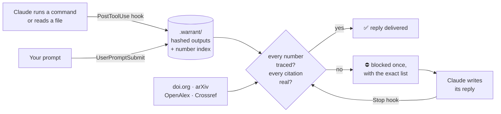

<div align="center">

# warrant

### Claude can't make up numbers or citations in your research anymore.

Every number Claude reports must trace to a command that actually ran.<br>
Every citation is checked against real registries. No model is involved, just code.

[](LICENSE)
[](pyproject.toml)
[](pyproject.toml)
[](#install)


</div>

---

## Try it on any paper first: 10 seconds, no setup

```bash
pip install warrant-research
warrant audit 1706.03762        # any arXiv id or URL, or your refs.bib / main.bbl
```

```
XX  [fake1] Recursive Spectral Gating Improves Long-Context Retrieval in Sparse Mixture Transformers
      no work with this title in OpenAlex or Crossref
XX  [fake2] Neural Gradient Folding for Self-Supervised Protein Design
      no work with this title in OpenAlex or Crossref

3 references: 1 verified, 0 unchecked, 2 not found anywhere
```

Each reference is checked against **doi.org, arXiv, OpenAlex and Crossref**. The output above is from a test `.bib` with two planted fakes.

warrant only flags a reference when no registry has ever heard of its title. A broken DOI on a real paper comes back "unchecked", never "fake". Run it on your own paper before a reviewer does.

---

## What it does inside Claude Code

<table>
<tr>
<td width="33%" valign="top">

### 🔢 Numbers need a source

Hooks capture every command output and every file Claude reads. Before a reply finishes, each decimal and percentage in it is traced:
- to an exact value, within rounding;
- to a mean of per-seed values;
- or to a difference or ratio of traced numbers.

If any number came from nowhere, the reply is blocked.

</td>
<td width="33%" valign="top">

### 📚 Citations get looked up

DOIs, arXiv ids and quoted paper titles in Claude's replies are resolved live. The reply is blocked for:
- a DOI that doesn't exist;
- a real id pointing at a different paper;
- a title nobody published.

</td>
<td width="33%" valign="top">

### 🧭 The question stays in view

Your research question rides along every turn. Hypotheses are **pre-registered**, and code decides the verdict. Refuted ideas go to a **graveyard**, and Claude is warned when it tries to revive one.

</td>
</tr>
</table>

What Claude sees when it tries to wing it:

```
Claude: Smoothing improves validation accuracy to 0.874 (vs 0.809 baseline),
        consistent with Müller et al. (doi 10.48550/arXiv.1906.99999).

[warrant] Your reply has numbers that no command output, file, or record entry
produced: 0.874 and citations that do not resolve or do not match:
doi:10.48550/arXiv.1906.99999 (DOI does not exist). Run the command that produces
each number, fix or remove the citation, or label a number as an estimate with '~'.
```

Claude then runs the experiment, or marks the number as an estimate, and fixes the citation. You get a write-up you can trust without re-checking it line by line.

---

## Install

```bash
# 1. the plugin
/plugin marketplace add ItsShreyamHere/warrant
/plugin install warrant@warrant

# 2. in a research project
warrant init "Does label smoothing help on our 5k-example setup?"
```

That's it. Hooks stay silent in projects without `warrant init`. You need Python 3.10+ on macOS, Linux or Windows. The CLI (`pip install warrant-research`) is optional, because the hooks ship with the plugin.

---

## How it works



**Why code and not a model?** Research agents grade their own homework. 2026 studies of autonomous research agents found they game their own evaluations on a large share of research tasks. Telling them the rules does not reliably stop them. A second model checking the first has the same problem. warrant takes the verdict away from the model:

| | |
|---|---|
| **Provenance, not plausibility** | A number is either in a captured output or it isn't. Text Claude wrote, or wrote and read back, never counts. |
| **Pre-registration** | The refutation test is committed before results exist. A missing metric is `inconclusive`, never a silent pass. |
| **Tamper-evident** | Every captured output and log is hashed, and the record is a hash chain. Editing history or a log is detected. |
| **Quiet by default** | Code blocks, dates, versions, section numbers and `~estimates` are ignored. Each reply is blocked at most once. |

---

## More tools

<details>
<summary><b>See where every number in a draft came from</b></summary>

```bash
warrant report --draft results.md   # HTML: green numbers show their source line on hover, red ones came from nowhere
warrant trace results.md --all      # the same, in the terminal
```

```
OK         0.812  mean: observation #2: Bash: python train.py --smoothing 0.1 --seeds 3
OK        81.79%  exact: observation #2: Bash: python train.py --smoothing 0.1 --seeds 3
OK         0.796  mean: observation #2: Bash: python train.py --smoothing 0.1 --seeds 3
OK         0.016  derived: derived from other reported numbers
XX          2.3%  untraced        <- "matches the 2.3% gain reported by ..." (never checked)
XX          0.84  untraced        <- "we expect 0.84 with longer training" (a guess)
```
</details>

<details>
<summary><b>Pre-registered experiments</b></summary>

```
$ warrant claim "label smoothing 0.1 improves val acc over baseline"
claim #1
$ warrant predict 1 '{"metric":"val_acc","op":"le","of":"baseline"}'   # before running
$ warrant result 1 --observed val_acc=0.806 --baseline val_acc=0.809
claim #1: refuted                                                      # -> graveyard
```

Wording is checked against evidence too. "Significantly" needs 3+ seeds and p < 0.05. "Proves" needs a proof. Strong results hedged into "may slightly help" get a note.
</details>

<details>
<summary><b>Reference checks in CI</b></summary>

```yaml
# .github/workflows/references.yml
on: [push, pull_request]
jobs:
  references:
    runs-on: ubuntu-latest
    steps:
      - uses: actions/checkout@v4
      - uses: ItsShreyamHere/warrant@v0
        with:
          files: refs.bib
```
</details>

<details>
<summary><b>All commands</b></summary>

| command | does |
|---|---|
| `warrant init [QUESTION]` | turn warrant on for this project |
| `warrant audit ARXIV_ID \| FILE` | check every reference in a paper or bibliography |
| `warrant cites FILE` / `warrant trace FILE` | check a draft's citations / numbers |
| `warrant report [--html \| --draft FILE]` | every claim with its verdict, or a draft with every number marked |
| `warrant question TEXT [--hypothesis H]` | set or change the research question |
| `warrant claim TEXT` | record a claim (warns if it resembles a dead idea) |
| `warrant predict N JSON` / `warrant result N --observed k=v` | pre-register, then let code decide |
| `warrant evidence N --log F --metric k=v [--seeds S --p P]` | attach run evidence (hashed) |
| `warrant evidence N --type cite --ref ID [--quote Q]` | attach a citation (resolved, quote checked against the abstract) |
| `warrant kill IDEA` / `warrant retract N` / `warrant status` | graveyard, withdraw, overview |
</details>

---

## Limits, stated plainly

- Tracing proves a number was **produced**, not that the code producing it is correct.
- `echo 0.93` produces a 0.93. The audit trail records the command, but warrant doesn't flag it: it is tamper-evident, not tamper-proof.
- Quote checks use the abstract. A quote that only appears in the full text comes back "unverified", never "fake".
- Whole numbers ("15 minutes") are not traced unless `WARRANT_STRICT=1`, to avoid false alarms.

**Roadmap:** Lean 4 / SymPy proof receipts · drift detection beyond the question anchor · live dashboard · CI badge.

<div align="center">

MIT licensed · built for researchers who'd rather be right than impressive

</div>
